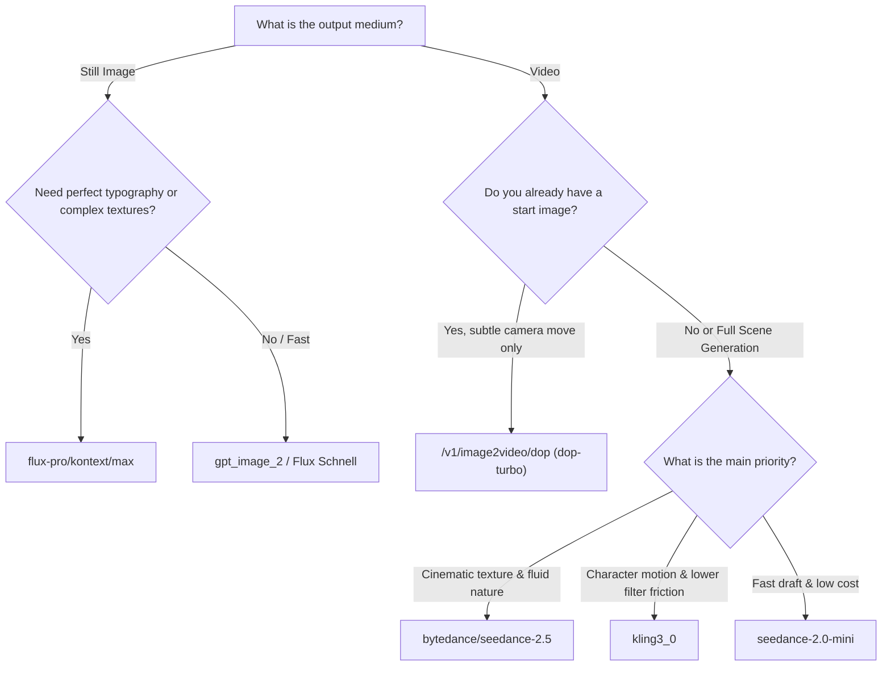

# Higgsfield Model Evaluation Matrix & Cost Guide

When generating content through Higgsfield, choosing the wrong model can lead to wasted credits, unexpected output formats, or failed jobs. Use this guide to select the optimal model based on visual requirements and budget.

---

## 1. Video Generation Models

### `bytedance/seedance-2.5/text-to-video` (and `seedance_2_0`)
- **Primary Use**: High-end documentary textures, natural fluid motion, cinematic lighting, and product hero shots.
- **Accepted Inputs**:
  - `prompt`: String (supports comprehensive camera directions and atmospheric modifiers).
  - `duration`: `5` or `10` seconds.
  - `resolution`: `'720p'` or `'1080p'`.
  - `aspect_ratio`: `'16:9'`, `'9:16'`, `'1:1'`.
- **Latency**: 3 to 8 minutes per clip.
- **Cost**: High (approx. 25–70 credits depending on resolution and duration).
- **Caveats**:
  - Content safety filter can be strict on words resembling human anatomy or natural substances.
  - Always submit with decoupled polling (`withPolling: false`).

---

### `kling3_0` / `kling-v1.5/text-to-video`
- **Primary Use**: Human character movements, physical interactions, dynamic action shots, and fallback when Seedance triggers NSFW false positives.
- **Accepted Inputs**:
  - `prompt`: String.
  - `duration`: `5` or `10` seconds.
  - `sound`: `'off'` (sound defaults to on in some endpoints; explicitly disable if not needed).
  - `start_image` / `end_image`: Supported for frame-locked camera dives or transitions.
- **Resolution**: Native 720p (does not accept a `--resolution` param in Kling v1/v3; do not pass resolution flags to avoid schema validation errors).
- **Latency**: 2 to 5 minutes per clip.
- **Cost**: Medium (approx. 15–35 credits).
- **Caveats**: More permissive filter than Seedance. High temporal stability.

---

### `bytedance/seedance-2.0/mini`
- **Primary Use**: Rapid prototyping, storyboard verification, pre-visualization of camera moves before committing to final high-resolution renders.
- **Accepted Inputs**:
  - Same core input schema as Seedance standard, capped at 720p.
- **Latency**: 1 to 3 minutes.
- **Cost**: Low (approx. 8–15 credits).
- **Caveats**: Less fine micro-texture; perfect for testing prompt phrasing.

---

### `/v1/image2video/dop` (`dop-turbo`)
- **Primary Use**: Adding micro-movement, organic breathing, and subtle camera parallax to an existing static image.
- **Accepted Inputs**:
  - `model`: `'dop-turbo'`
  - `input_images`: Array with `{ type: 'url' | 'base64', data: '...' }`
  - `prompt`: Short camera direction.
- **Latency**: 45 to 90 seconds.
- **Cost**: Low to Medium.
- **Caveats**: Does not generate new scenes from scratch; requires a high-quality initial frame.

---

## 2. Image Generation Models

### `flux-pro/kontext/max/text-to-image`
- **Primary Use**: Hero graphic design, precise typography rendering, complex multi-object composition, photorealism.
- **Accepted Inputs**:
  - `prompt`: Detailed scene description.
  - `aspect_ratio`: `'16:9'`, `'9:16'`, `'1:1'`, `'3:2'`.
  - `seed`: Integer (optional for reproducibility).
  - `safety_tolerance`: 1 to 5.
- **Latency**: 15 to 45 seconds.
- **Cost**: Premium tier.

---

### `gpt_image_2` / Flux Schnell
- **Primary Use**: Rapid visual exploration, isometric diorama stills, clean solid backgrounds for cutouts.
- **Latency**: 10 to 30 seconds.
- **Cost**: Low tier.

---

## 3. Decision Tree: Which Model to Pick?

